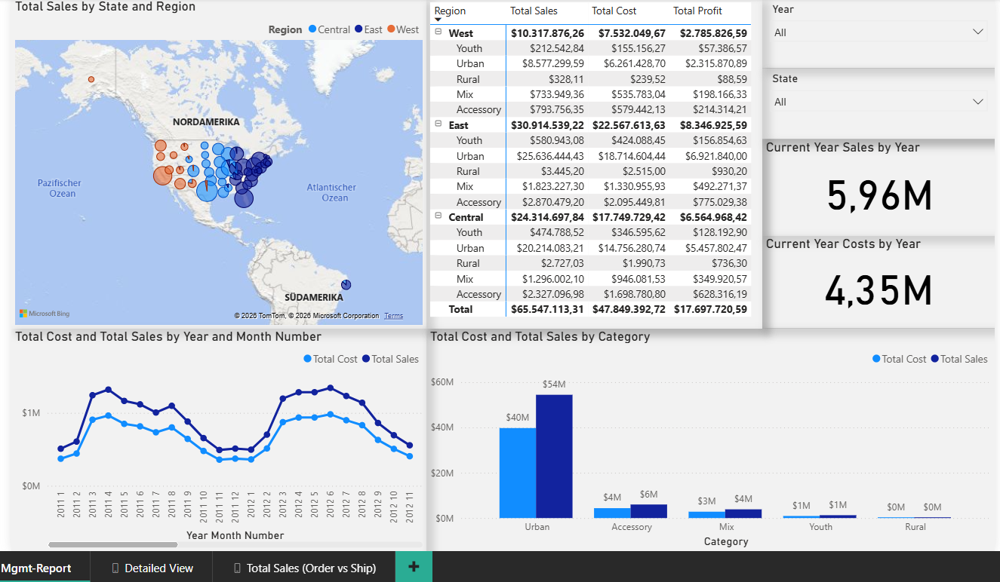
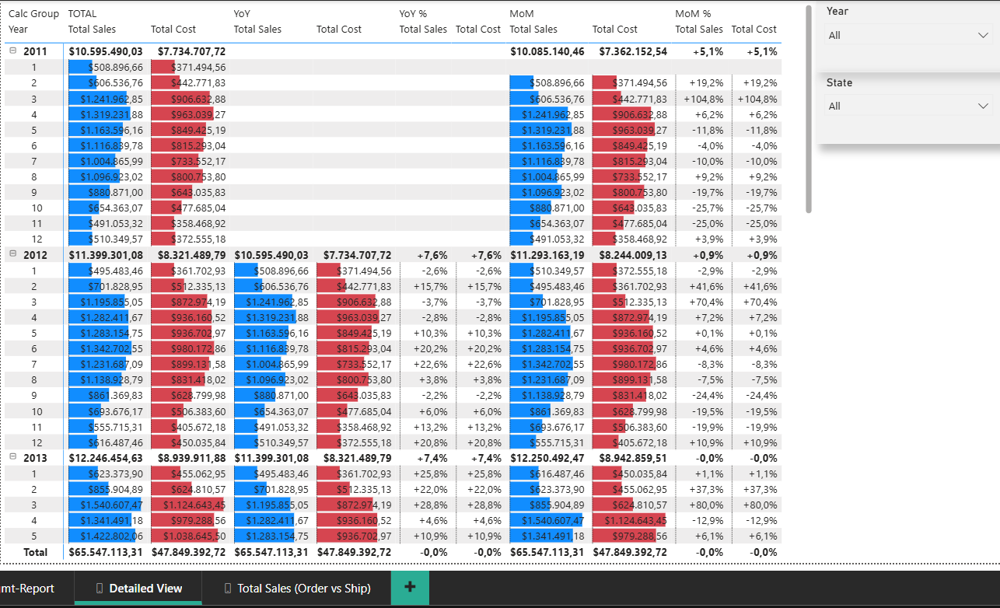
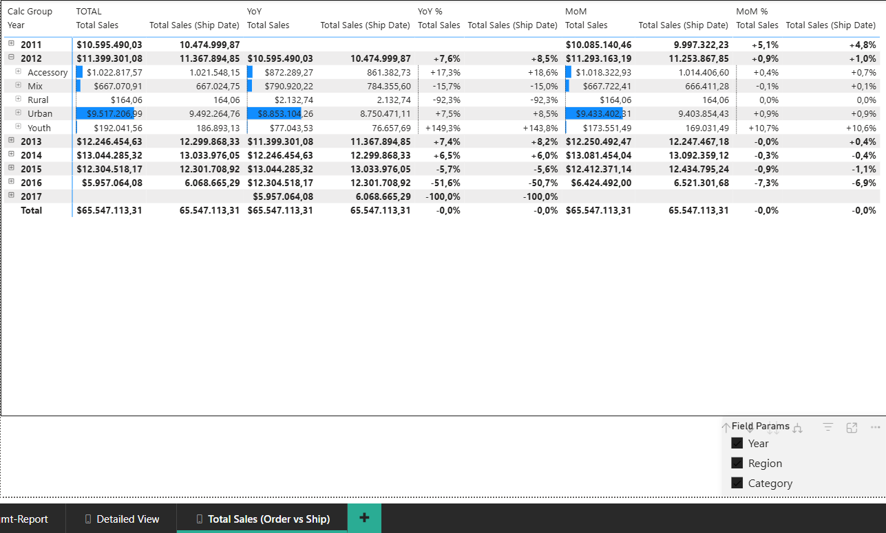
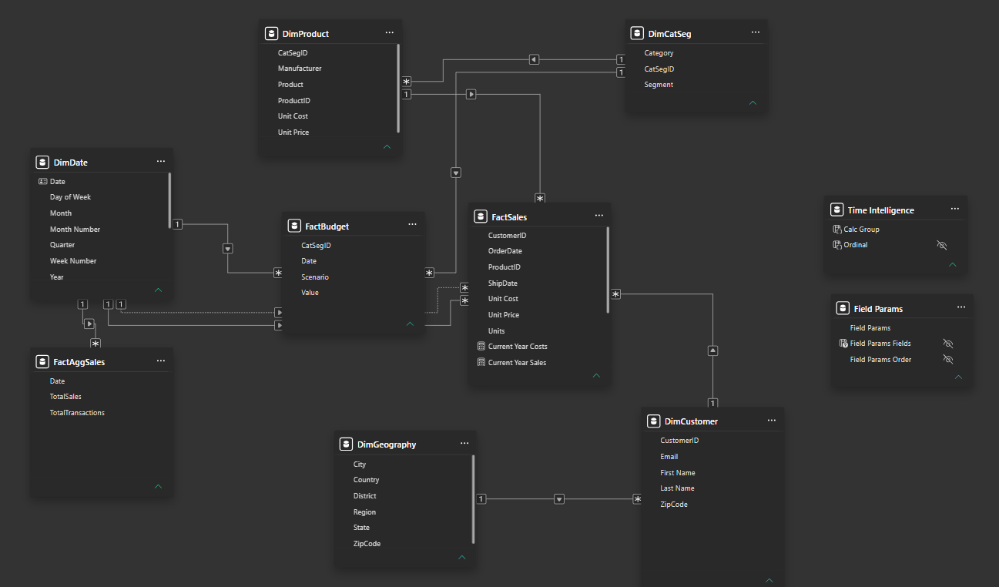

---

## 1. Data Architecture & ETL Pipeline (`1_ETL/`)

The data warehouse follows a classic **Star Schema** design with an upstream staging layer to cleanse source data and optimize analytical query performance.

### Technical Highlights
* **Idempotent Load Processes:** Re-running ETL jobs (e.g., after a failure) prevents duplicate records in the fact table.
* **Transaction Safety & Error Handling:** All ETL procedures implement `SET XACT_ABORT ON` alongside structured `TRY...CATCH` blocks.
* **Centralized Execution Logging:** Every run tracks start/end timestamps, execution status (`RUNNING`, `SUCCESS`, `FAILED`), affected row counts (`InsertedRows`, `UpdatedRows`), and detailed SQL error messages in `dbo.ETL_ExecutionLog`.
* **Automation:** A multi-step **SQL Server Agent Job** orchestrates execution order (loading dimensions before facts).

---

## 2. Power BI Dashboard (`2_PowerBI/`)

The report uses the **Power BI Project format (`.pbip`)**, enabling clean version control of report and semantic model definitions in Git.

### Management Overview

* **Focus:** Core sales KPIs (revenue, units sold, margin, period-over-period comparisons) designed for executive decision-making.
* **Interactivity:** Dynamic filtering by time period, region, and customer segments via slicers and cross-filtering.

### Detailed View

* **Focus:** Granular breakdown across product categories, customer segments, and regional performance.

### Order vs. Sales View

* **Focus:** Comparison of order volume versus realized sales over time to identify trends, seasonality, and fulfillment gaps.

### Data Model (Star Schema)

* **Modeling:** Clean separation between the fact table (`FactInternetSales`) and dimension tables using one-to-many (`1:N`) relationships for efficient DAX calculations.

---

## Tech Stack
* **Database & ETL:** Microsoft SQL Server, T-SQL, SQL Server Agent
* **BI & Visualization:** Microsoft Power BI Desktop (`.pbip`), DAX, Power Query
* **Version Control:** Git & GitHub